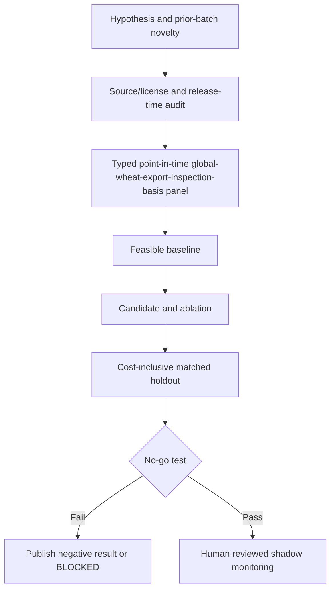

# WORKFLOW — Wheat Export Inspection Revisions to Global Basis and Calendar Spreads

## Decision-specific gates
1. Scope: Hedge wheat calendar spreads around official export inspection versus world balance-sheet information releases.
2. Acquire only USDA AMS export grain inspections dashboard, USDA wheat supply/price tables, official crop calendars, futures curves and export policy announcement records. as legally allowed; USDA dashboard launched Oct 14 2026 and wheat tables updated Nov 12 2026; do not replace historic reports with latest annual revisions.
3. Check mathematical constraints: r region; expected inspections estimated using only pre-release history; h is post-release decision horizon with realistic market access.
4. Test `Monthly seasonal wheat spread regression using last known WASDE` versus `Mixed-frequency distributed-lag export surprise model` on same opportunity set and costs.
5. Challenge result with: Weekly inspections differ from actual export commitments; Black Sea supply and policy announcements may dominate.
6. Pre-committed stop: No predictive improvement after weather, futures calendar effects and contemporaneous official release lags.
7. Present spread forecast delta, regional basis tracking, net slippage-adjusted hedge P&L, regime robustness and capital/execution capacity (CME wheat futures tick, spread roll, physical basis accessibility and region transport costs.).
8. Human review and explicit rollback. Negative outcomes remain research output.

**No workflow, connector or runtime was executed for this proposal.**
