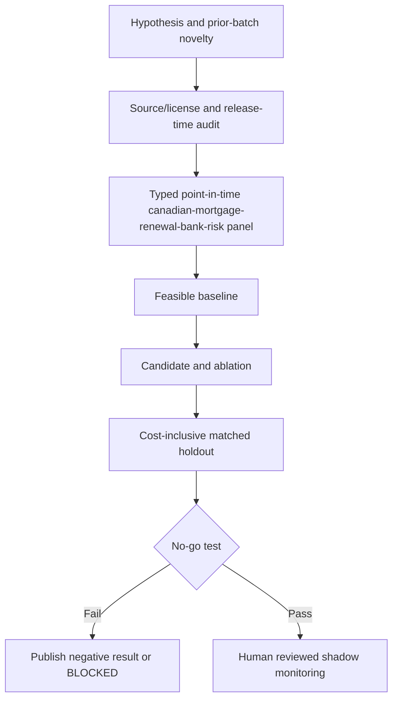

# WORKFLOW — Canadian Mortgage Renewal Cohorts to Bank Credit-Risk Dispersion

## Decision-specific gates
1. Scope: Hedge Canadian bank credit/equity risk using public maturity-cohort mortgage renewal exposure rather than broad unemployment alone.
2. Acquire only Bank of Canada public mortgage balances/rates, staff renewal methodology, bank annual/quarterly mortgage disclosures, CAD rate and housing data. as legally allowed; Use released monthly tables and historical market expectations before renewal; a 2025 note's projected 2026 payments are scenario assumptions, not observed outcomes.
3. Check mathematical constraints: Balance is refinanceable exposure (public aggregate proxy initially), ECL expected credit loss; individual bank vintage mapping may be incomplete.
4. Test `Bank loss sensitivity to national unemployment and policy rate alone` versus `Vintage-cohort mortgage reset microsimulation from public aggregates` on same opportunity set and costs.
5. Challenge result with: Public aggregate cohorts do not identify each bank's borrower vintage distribution or underwriting quality.
6. Pre-committed stop: No cross-bank predictive signal after public loan books and unemployment/rate controls, or estimates too wide to act on.
7. Present future loss forecast gain, bank-spread risk hedging, sensitivity to vintage assumptions, net hedging cost and capital/execution capacity (TSX bank/equity/CDS liquidity, CAD FX basis, sector beta hedges and credit market impact.).
8. Human review and explicit rollback. Negative outcomes remain research output.

**No workflow, connector or runtime was executed for this proposal.**
