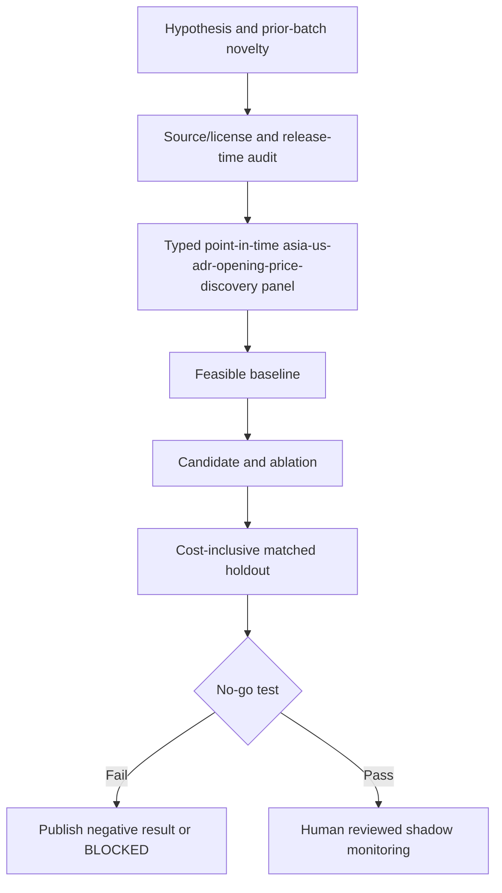

# WORKFLOW — Asia–US Cross-Listed ADR Opening Auction Information Transfer

## Decision-specific gates
1. Scope: Choose hedge and execution timing for US ADR versus home-market overnight fair value.
2. Acquire only Issuer depositary receipts ratios, local listings, public filings, FX quote timestamps, US ADR opening auctions, dividends and corporate action history. as legally allowed; Prevent local-price forward fill across sessions; ratio/corporate actions must be known at the US quote decision time.
3. Check mathematical constraints: Ratio_i is point-in-time ADR share ratio, FX has correct currency direction, CrossMarketNews is post-local close information known before US auction.
4. Test `Last home close × publicly known ADR conversion ratio × contemporaneous FX spot` versus `State-space asynchronous Kalman fair-value update using futures and related peer prices` on same opportunity set and costs.
5. Challenge result with: ADR conversion fees, access restrictions, local holidays and stale home quotes create phantom arbitrage.
6. Pre-committed stop: No consistent opening execution improvement after financing, foreign exchange, depositary and auction spread costs.
7. Present auction fair-value error, paired realized slippage, inventory risk, settlement/convertibility feasibility and capital/execution capacity (ADR opening auction depth, ADR conversion channel capacity, local/US holiday and FX hedging constraints.).
8. Human review and explicit rollback. Negative outcomes remain research output.

**No workflow, connector or runtime was executed for this proposal.**
