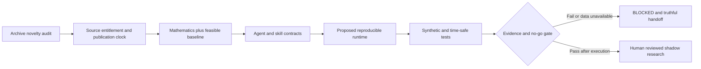

# Twenty-idea agentic research workflow

## Proposed shared Python packages (not implemented)
- `qmg_core/sources/`: public/paid/private rights metadata and source-vintage capture.
- `qmg_core/point_in_time/`: availability-time joins, market calendars, revision-safe features and leakage guards.
- `qmg_core/contracts/`: typed cross-research data schemas and synthetic fixtures.
- `qmg_core/economics/`: cost/volume/capacity and hypothetical ROI envelope.
- `qmg_core/validation/`: purged chronological splits, paired holdout economics, multiplicity control, bootstrapped confidence intervals.
- `qmg_core/agents/`: typed tool approvals, evidence/claim ledger and reviewer arbitration.
- `qmg/research/<slug>/`: per-idea baseline/candidate/counterfactual and metrics.

## Sequence
1. Compare all archived decision/objectives and reject near duplicates.
2. Source official papers/portals and record publication/available times separately.
3. Specify H1/H0, feasible baseline, cost constraints, negative tests and exact stop gate.
4. Generate project-specific AGENT/SKILL/PROMPT/TOOLING/WORKFLOW/RUNTIME/EVALS designs.
5. No CI/test result is presumed. Validate Markdown paths/filenames and file count in PR.
6. Human reviewers decide on source rights, implementation gate, negative results and deployment; never auto-merge.
7. Send one Slack digest after GitHub PR is confirmed.

This batch is **documentation only**; the workflow describes future actions, not work already completed.
