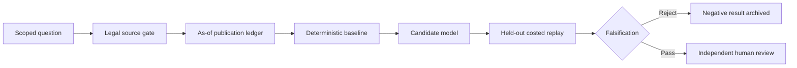

# WORKFLOW — Securities Loan Retroactive Rate Amendment Revenue Assurance

1. **Domain:** Global agent lending / US securities loans; decision: Identify contractually unsupported retroactive fee amendments before invoice posting..
2. **Source and licensing:** SEC EDGAR Data Access, BIS Basel III Monitoring Release, Sep 23 2026 are public starting points; Commercial corporate actions, loan accounting system documentation is gated until entitlement.
3. **Temporal contract:** Invoice run includes only fee amendments authorized and received before invoice cut-off, even if effective date is earlier.
4. **Baseline:** Latest agreed fee × end-period balance × elapsed days with full operational cost and feasible eligibility.
5. **Model:** Bitemporal finite-state rate and loan lifecycle ledger with invariant checks, then justify any additional complexity in Probabilistic anomaly prioritization atop an exact contract-aware billing engine.
6. **Horizon:** pre-register holdout, embargo overlapping outcomes, stress Contract-level bilateral waiver rules, fee confirmation ambiguity and out-of-order event feeds..
7. **Outcome:** Synthetic exception precision/recall, manual hours, invoice basis-point leakage, false escalation rate. Stop if No improvement in high-severity seeded exceptions relative to deterministic ledger, or unauthorized dispute actions..
8. **Review:** separate generated narrative, deterministic results, human signoff and optional shadow monitoring. No live trade path included.

**On any missing licence, timestamp or constraint return BLOCKED.**
