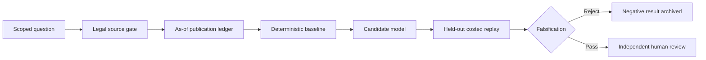

# WORKFLOW — Tri-Party Repo Margin Dispute Root-Cause and Evidence Classifier

1. **Domain:** US and European tri-party collateral; decision: Resolve margin disagreements by independently identifying stale marks, eligibility mismatches and cut-off conventions..
2. **Source and licensing:** OFR US Repo Markets Data Release, BIS Basel III Monitoring Release, Sep 23 2026 are public starting points; Tri-party margin conventions and licensed independent pricing feeds is gated until entitlement.
3. **Temporal contract:** Use values known to both parties at agreed margin timestamp; never use later corrected marks to excuse earlier action.
4. **Baseline:** FIFO triage by dispute amount and ticket keywords with full operational cost and feasible eligibility.
5. **Model:** Deterministic valuation reconciliation then provenance-based root-cause ranking, then justify any additional complexity in Constrained language-model document extraction with deterministic verifier and abstain-on-conflict.
6. **Horizon:** pre-register holdout, embargo overlapping outcomes, stress Conflicting vendor marks, jurisdiction-specific terms, privacy and LLM overconfidence..
7. **Outcome:** Seeded root-cause accuracy, false escalations, time-to-resolution, unresolved material exposure. Stop if LLM cannot improve verified resolver without hallucinated legal clauses or unacceptable false settlements..
8. **Review:** separate generated narrative, deterministic results, human signoff and optional shadow monitoring. No live trade path included.

**On any missing licence, timestamp or constraint return BLOCKED.**
