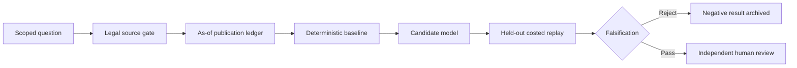

# WORKFLOW — Fed Standing Repo Facility as a Funding-Stress Option Exercise Signal

1. **Domain:** US overnight secured funding; decision: Monitor time-lagged facility usage and infer when broad repo funding stress warrants buffer review..
2. **Source and licensing:** NY Fed Standing Repo Facility FAQ, OFR US Repo Markets Data Release, New York Fed Primary Dealer Statistics are public starting points; Intraday secured-funding quotations and market depth is gated until entitlement.
3. **Temporal contract:** Use posted operation result time and repo series 1-2-day publication lags; do not use same-day hidden participant-level bids.
4. **Baseline:** SOFR-GC spread threshold with no SRF information with full operational cost and feasible eligibility.
5. **Model:** Event-conditioned calibrated logistic hazard with lag-safe publication ledger, then justify any additional complexity in Structural real-option exercise mapping latent facility usage and dealer cash constraints.
6. **Horizon:** pre-register holdout, embargo overlapping outcomes, stress SRF operational parameter changes, known policy regime shifts, lack of entity-level same-day data..
7. **Outcome:** Brier score, AUPRC, stress false alarm, lead-time, calibrated probability. Stop if No holdout information gain after timing correction, or false positives overwhelm funding buffer costs..
8. **Review:** separate generated narrative, deterministic results, human signoff and optional shadow monitoring. No live trade path included.

**On any missing licence, timestamp or constraint return BLOCKED.**
