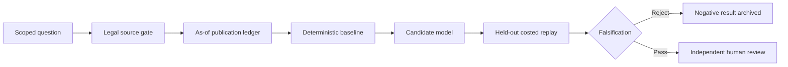

# WORKFLOW — Chile–Peru Copper Royalty Shock to Sovereign and Mining Credit

1. **Domain:** Chile and Peru, mining and sovereign USD/local-currency credit; decision: Hedge commodity-linked fiscal and issuer credit risk around public mining tax and royalty changes..
2. **Source and licensing:** USGS Mineral Commodity Summaries 2026 dataset, SEC EDGAR Data Access are public starting points; LATAM sovereign CDS, mining corporate bond and local FX data is gated until entitlement.
3. **Temporal contract:** Policy event recognized at official publication/enactment time; annual USGS data only upon issuance.
4. **Baseline:** Copper price beta plus sovereign spread changes with full operational cost and feasible eligibility.
5. **Model:** Event study with cross-sectional mine exposure and staggered law timing, then justify any additional complexity in Partial equilibrium mine-option tax model under investment deferral and country sovereign budget feedback.
6. **Horizon:** pre-register holdout, embargo overlapping outcomes, stress Anticipatory legislative pricing, issuer/sov high correlations, illiquid local bond prices..
7. **Outcome:** Event abnormal spread, FX-adjusted carry, political timing placebo, credit risk attribution. Stop if No holdout effect after commodity beta and country shock controls or cannot identify legal effective date..
8. **Review:** separate generated narrative, deterministic results, human signoff and optional shadow monitoring. No live trade path included.

**On any missing licence, timestamp or constraint return BLOCKED.**
