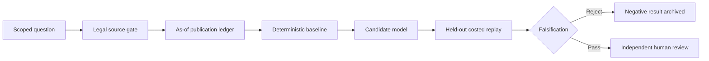

# WORKFLOW — Biotech FDA Catalyst Probability versus Options Event Premium

1. **Domain:** US small/mid-cap biotech equity and listed options; decision: Test whether equity option implied event moves overstate conditional post-decision realized jumps at fixed risk limits..
2. **Source and licensing:** openFDA Drugs@FDA, SEC EDGAR Data Access, Cboe Historical Options Market Statistics are public starting points; OptionMetrics/OPRA historical executable bid-ask quotes is gated until entitlement.
3. **Temporal contract:** No use of FDA outcome until public approval announcement; option quotes at last feasible pre-event time.
4. **Baseline:** Historical absolute event returns grouped by market cap and indication with full operational cost and feasible eligibility.
5. **Model:** Regulatory-document event taxonomy + shrinkage conditional jump model, then justify any additional complexity in Hierarchical Bayesian decision-state model and option-neutral density decomposition.
6. **Horizon:** pre-register holdout, embargo overlapping outcomes, stress FDA database daily updates can lag original approval; sample selection, delistings and halted option quotes..
7. **Outcome:** Jump variance calibration, option VRP after costs, event coverage, tail hedge error. Stop if Conditional probability model fails event-matched calibration or net executable option premium..
8. **Review:** separate generated narrative, deterministic results, human signoff and optional shadow monitoring. No live trade path included.

**On any missing licence, timestamp or constraint return BLOCKED.**
