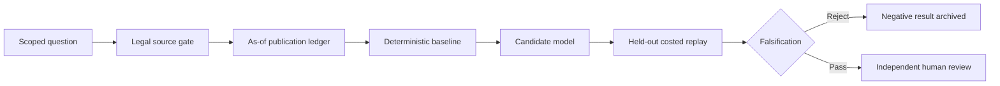

# WORKFLOW — Sovereign DSA Rating Migration Event Pricing for Frontier Bonds

1. **Domain:** Frontier Africa and select emerging Asia sovereign USD credit; decision: Prioritize bond credit watchlists around IMF/World Bank debt sustainability status changes..
2. **Source and licensing:** IMF Sovereign Risk/DSA Publications, World Bank Public DSA Country Repository are public starting points; Frontier sovereign historical bid/ask, CDS and restructuring claims is gated until entitlement.
3. **Temporal contract:** Country report posting time and rating applicability; embargo unpublished staff papers and revisions.
4. **Baseline:** Latest public debt-to-GDP and reserves ratio with full operational cost and feasible eligibility.
5. **Model:** Multi-state ordinal risk migration model with publication-aligned survival validation, then justify any additional complexity in Bayesian sovereign hazard with IMF policy intervention and restructuring recovery scenarios.
6. **Horizon:** pre-register holdout, embargo overlapping outcomes, stress DSA coverage selection and program endogeneity, non-tradable distressed bonds, rare default events..
7. **Outcome:** Default Brier score, out-of-time risk precision, spread change, no-trade capacity flags. Stop if No improvement over conservative sovereign ratings baseline, or price move entirely before public timestamp..
8. **Review:** separate generated narrative, deterministic results, human signoff and optional shadow monitoring. No live trade path included.

**On any missing licence, timestamp or constraint return BLOCKED.**
