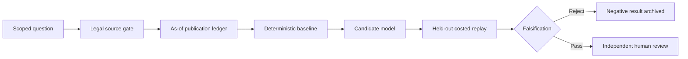

# WORKFLOW — US Bank Deposit Beta and Mark-to-Market Securities Run Risk

1. **Domain:** US regional banks and bank-sector equity/credit; decision: Assess which banks face funding-cost and securities-loss convexity under uninsured deposit migration..
2. **Source and licensing:** FDIC Bank Financial Reports, FRED Data Portal are public starting points; Bank funding rate panels and credit spread datasets is gated until entitlement.
3. **Temporal contract:** Quarter-end balances become usable only at the first public Call Report publication, not period end.
4. **Baseline:** Uninsured deposit share plus book capital ratio with full operational cost and feasible eligibility.
5. **Model:** Hierarchical deposit beta estimation plus accounting-based duration stress, then justify any additional complexity in Agent-based depositor migration with liquidity haircut and contagion sensitivity.
6. **Horizon:** pre-register holdout, embargo overlapping outcomes, stress Quarterly revisions, mergers, bank survivorship and missing bank-specific deposit pricing..
7. **Outcome:** Next-quarter NII loss, downside rank precision, capital shortfall, sector-neutral return IC. Stop if No incremental forecast versus capital/deposit mix baseline after strict public release lag..
8. **Review:** separate generated narrative, deterministic results, human signoff and optional shadow monitoring. No live trade path included.

**On any missing licence, timestamp or constraint return BLOCKED.**
